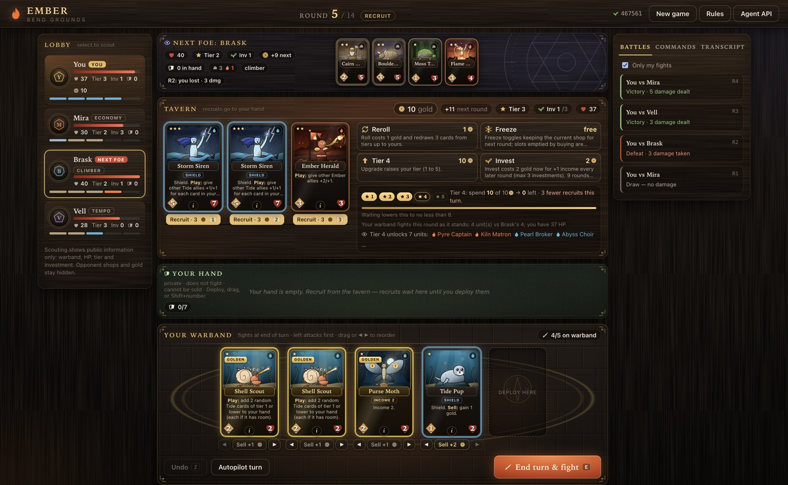
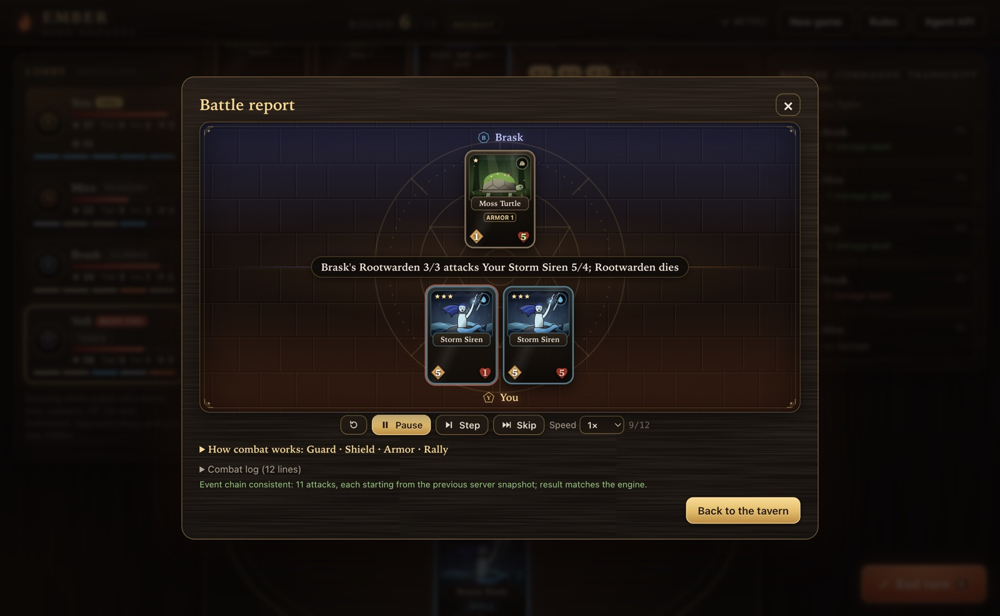
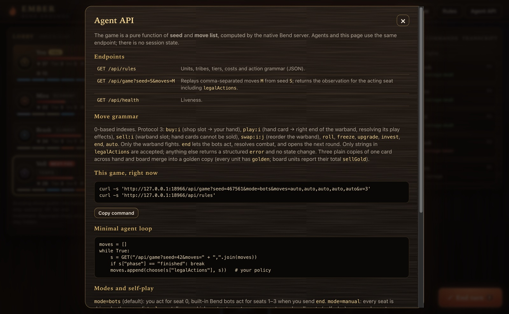

<div align="center">

# Ember · Bend Grounds

**An autobattler where Bend 2 owns the game—not just a demo function.**

[](engine/game.bend)
[](engine/main.bend)
[](#meet-rook)
[](LICENSE)

[Play locally](#build-and-play-locally) · [Inside Bend](#why-bend) · [Run Rook](#meet-rook) · [Agent API](docs/AGENTS-API.md) · [Verification](docs/VERIFICATION.md)



**4 players · 44 cards · Golden merges · Seeded replays · Bring your own agent**

</div>

Recruit a warband, build an economy and watch it clash. Combine three copies into a golden unit, scout the next opponent, and decide whether to buy power now or invest in later rounds. Play one seat against **Rook**, watch the bots, or plug in your own policy.

**Runs locally.** No hosted demo, model download or API key is required. The authoritative engine, built-in bots, observations, legal actions and native HTTP backend are written in Bend 2; the browser is a vanilla JavaScript client.

**Contributing with a coding agent?** Start with [AGENTS.md](AGENTS.md), then use the [development task map](docs/DEVELOPMENT.md) to load only the guidance relevant to your change. Game-playing policies use the separate [Agent API](docs/AGENTS-API.md).

## Build and play locally

Requirements: Git, [Bun](https://bun.sh), a compatible Clang toolchain, Python 3, `curl` and `shasum`. Python game clients use only the standard library. The existing development baseline is macOS; portability is not claimed. See [Toolchain](docs/TOOLCHAIN.md) for the compiler pin and proof prerequisites.

From the repository root:

```sh
bash scripts/setup.sh
bash scripts/build.sh
bash scripts/start.sh --fg
```

Open **http://127.0.0.1:8765** in your browser. Choose **Versus bots** to play one seat against three built-in Bend bots. Stop a foreground server with Ctrl+C.

On macOS, `./Play.command` checks the toolchain and native build provenance, rebuilds if needed, starts a background server and opens the browser. You can also start a background server directly:

```sh
bash scripts/start.sh
```

Foreground mode is recommended for simple lifecycle control. There is no automatic stop command: for a background server, inspect the process before stopping it; PID files are informational only. A second launch refuses to adopt a server already answering on the selected port. Stop that process explicitly after identifying it, or choose another port, for example `BG_PORT=8766 bash scripts/start.sh --fg`.

The build invokes the pinned Bend compiler with Bun and produces three native executables: `build/server`, `build/cli` and `build/runner`, plus provenance manifests. Bun runs the compiler, not the game server. Rebuild after changing Bend sources; the agent transports reject missing or stale native builds rather than silently selecting another backend.

## A look inside

<table>
<tr>
<td width="50%"><a href="docs/images/combat.jpg"></a></td>
<td width="50%"><a href="docs/images/agent-api.jpg"></a></td>
</tr>
<tr>
<td><strong>Replay every clash.</strong> Step through combat events and board snapshots supplied by Bend.</td>
<td><strong>Bring your own agent.</strong> Humans and policies act through the same rules engine.</td>
</tr>
</table>

Screenshots are from a real local game, seed `467561`. Click to inspect the full-size images.

## Why Bend?

This is a small end-to-end case study for the language: can the same Bend 2 codebase describe a playable state machine, serve it to a browser, expose it to agents, and state laws about its real transitions?

Bend is not a wrapper around a JavaScript game here. It owns the game:

- **State and rules:** [game.bend](engine/game.bend) defines players, actions, recruiting, seeded randomness, combat, round transitions and built-in bot policies. [econ.bend](engine/econ.bend) supplies the economy functions those rules use.
- **The interface to the rules:** legal actions, private/public observations, generated card text and JSON encoding also live in Bend. Humans and agents act through the same engine.
- **The native HTTP backend:** [main.bend](engine/main.bend) handles HTTP parsing, routing, static-file responses and TCP serving. There is no Python or JavaScript application server behind it.
- **Executable rules alongside explicit laws:** the proof files import the real engine. They do not prove a separate simplified model and assume it matches the game.

### A short source tour for language implementers

| Question | Start here |
| --- | --- |
| What does a nontrivial application look like in Bend 2? | [The game state machine](engine/game.bend): recruiting, economy, combat, golden merges and round progression. |
| Can the application own its I/O boundary? | [The native server](engine/main.bend): TCP serving, HTTP parsing/routing and static responses, with an explicitly `@unsafe` unbounded accept loop. |
| Can browser play and agent experiments share the semantics? | [CLI](engine/cli.bend) and [persistent runner](engine/runner.bend), alongside the HTTP interface; no second rules implementation in Python or JavaScript. |
| Do dependent laws touch executable application code? | [Economy laws](LAWS.bend), [recursive proofs](PROOF.bend), and [state-bound invariants](tests/engine_invariants.bend) import the real functions. |

The interesting boundary is between **executable rules, explicit laws and real I/O**—not a claim that the entire application has been proved. This release is a concrete application to read, run and question, rather than a GPU benchmark or a toy arithmetic-only proof.

### A law about the actual economy

For example, this statement from [LAWS.bend](LAWS.bend) says an affordable payment leaves exactly the remainder, for **every** natural-number cost and remainder:

```bend
law spend_pays:
  for cost: Nat
  for rest: Nat
  {Econ.spend(Nat.add(cost, rest), cost) == Some{rest} : Maybe<&2, Nat>}
```

The corresponding recursive proof is `Laws.spend_pays` in [PROOF.bend](PROOF.bend). This is an equality type referring directly to the `spend` function used by the engine—not a few example balances passing a test.

Other dependent proof results include `g_apply_zone_cap` and `replay_zone_cap` in [engine_invariants.bend](tests/engine_invariants.bend), which express preservation of board and hand bounds through real transitions and transcript replay. `legal_sound` in [action_laws.bend](tests/action_laws.bend) shows that typed `Act` values retained by `legal_filter` are accepted by `p_apply`: the filter itself tests that acceptance. This does not establish that JSON action strings survive the `act_str` / `parse_move` roundtrip, or that the action list is complete.

**Scope matters:** these are selected properties, not full-game correctness or balance. The HTTP server, serialization and complete combat/HP/ranking behavior are not universally verified. The server's unbounded accept loop is explicitly `@unsafe`. See [Verification](docs/VERIFICATION.md).

### What is not Bend?

The browser is vanilla HTML, CSS and JavaScript: it renders observations, submits actions and animates combat events supplied by Bend. Python provides policy plugins, clients, build helpers and tests. Policies choose actions; they do not implement authoritative legality or game transitions.

```text
Browser UI ── HTTP ──> Bend HTTP server ──> Bend rules engine
Agent client ────────> HTTP / native CLI / native runner
                                             └─ same rules engine
```

This targets the pinned **Bend 2** implementation in `bendlang/bend`, not the original Bend implementation commonly associated with HVM. It demonstrates neither GPU execution nor automatic parallel speedups, and makes no current performance claim.

**About GitHub's language bar:** this repository contains 14 Bend source/proof files. [Bend support is present in Linguist's source](https://github.com/github-linguist/linguist/blob/cfd7a0113aa1efab99faeff38756f0ed4d48add8/lib/linguist/languages.yml#L683-L692), but GitHub's deployed detector may lag behind it. `.gitattributes` explicitly identifies `*.bend` as Bend; the language bar is not a map of which language owns the game.

## How to play

Start with 40 HP. Each round brings fresh gold; unspent gold does not carry over.

| Action | What it does |
| --- | --- |
| Buy | Spend 3 gold to put a shop unit in your private hand, up to 7 cards. |
| Deploy | Play a hand card onto your board, up to 5 units. Only the board fights. |
| Sell | Remove a board unit for gold. Hand cards cannot be sold. |
| Reorder | Change board order; the leftmost unit attacks first. |
| Roll / freeze | Pay 1 gold for a new shop, or preserve unsold offers for next round. |
| Upgrade | Unlock higher-tier shop units. Waiting discounts the next upgrade to its floor. |
| Invest | Pay 2 gold for +1 income in later rounds, up to 3 investments. |
| End turn | Resolve end-of-turn effects, bot turns and automatic combat in versus-bots mode. |

Three regular copies across hand and board assemble into one golden card in your hand. Merges can change indexes: agents should read the new observation after each action. The in-game **Rules** panel and `/api/rules` provide the card list, costs and detailed mechanics directly from Bend.

**Watch bots:** open the **Commands** tab and choose **Autoplay to the end**. **Autopilot turn** delegates only the current turn. **Manual control** lets you act for each seat in turn. The **Transcript** tab can copy a replay link.

## Meet Rook

**Rook is included: our native Bend 2 heuristic bot, not a trained language model.** In **Versus bots**, it controls your three opponents. Its seat-dependent styles—**tempo, economy and climber**—make different spending and tiering choices.

The implementation lives in [`bot_choice` and `bot_play`](engine/game.bend). The CLI name is **`bot`**: it sends `auto` to Bend, delegating the entire turn to the native policy. There is no separate Python port to drift out of sync, no weights to fetch and no inference service.

After setup and build:

```sh
# Rook in your seat against the three built-in Rook opponents.
python3 scripts/agent.py --backend fast play --seed 4242 --policy bot

# A four-Rook lobby, with every seat controlled by the native bot.
python3 scripts/agent.py --backend fast selfplay --seed 4242 --policies bot

# Play interactively in the terminal against three Rook seats.
python3 scripts/agent.py --backend fast human --seed 4242 --policies bot,bot,bot
```

To play against Rook in the browser, start the server and choose **Versus bots**. To watch a whole game, open **Commands → Autoplay to the end**. Rook is a reproducible baseline for your own policies, not a claim of optimal or balanced play.

## Bring an agent

No model service or API key is required. Start with the included Python policy:

```sh
python3 scripts/agent.py rules
python3 scripts/agent.py play --seed 42 --policy scripts/example_policy.py:policy
python3 scripts/agent.py selfplay --seed 42 --policies tempo,econ,random,bot
python3 scripts/agent.py human --seat 0 --policies scripts/example_policy.py:policy,bot,bot
```

These use the persistent native Bend runner by default; a web server is not needed. A custom policy receives the acting seat's observation and returns one string from `legalActions`. Only load trusted policy files: plugins execute local Python code.

To use the same HTTP surface as the browser, with the server running:

```sh
python3 scripts/agent.py --backend http --url http://127.0.0.1:8765 play --seed 42 --policy tempo
curl 'http://127.0.0.1:8765/api/game?seed=42&mode=bots&v=3&moves=buy:0,play:0,end'
```

Save and verify a replay:

```sh
python3 scripts/agent.py play --seed 42 --policy tempo --save build/replay.json
python3 scripts/agent.py replay build/replay.json
```

See [Agent API](docs/AGENTS-API.md) for modes, protocol 3, observations and the plugin contract. This is an interface for writing agents, not a bundled trained language-model opponent.

## Built with agents

AI agents working in **Pi + OptChat** wrote most of the implementation; Aleksandr Podgaiko steered the project and made the final calls. The interesting part was not agent count, but coordinating ownership, checking results and turning a research workspace into a playable release. [A short workflow retrospective](docs/AGENT-WORKFLOW.md) covers what worked, what failed, and why local mock success was not enough.

## Verification and limitations

The canonical source-based release gate is:

```sh
bash scripts/verify.sh
```

In addition to build prerequisites, it requires Node.js and Lean v4.34.0 (`lean` and `leanc`, normally via elan). It rebuilds, checks provenance, exercises native and HTTP regressions against its own isolated server, and runs eight `--verdict` files. The default isolated port is 18965; override it with `BG_VERIFY_PORT`. An occupied port is refused rather than reused.

[Verification](docs/VERIFICATION.md) details the gate, focused checks and their limits. Building the game is not evidence that all proof and integration checks passed; even the gate does not replace a browser playthrough. No current gate PASS or historical acceptance count is claimed here.

The HTTP API replays `(seed, mode, moves)` without server-side game sessions. This makes branching and reproduction straightforward, but permits undo and lookahead. Manual-mode recruiting is sequential, so later seats see earlier seats' updated boards. This is a local game and agent playground—not authenticated multiplayer, secure ranked play, or a claim of balanced strategies.

## License and attribution

Bend Grounds' original game code and documentation are licensed under the [MIT License](LICENSE), copyright 2026 Aleksandr Podgaiko.

The [Bend compiler](https://github.com/bendlang/bend) is a separate **Apache-2.0** dependency, copyright 2026 HigherOrderCO, pinned to commit `52637f747b1f7e08263b7853ffd7204262d8e41e`. Setup fetches the compiler; this source release does not redistribute its checkout. Its license and notices remain applicable independently of this project's MIT license. See [Toolchain](docs/TOOLCHAIN.md).
